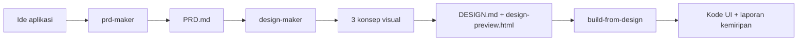

# PRD · Design · Build Skills

Tiga **Agent Skills** untuk mengubah ide aplikasi menjadi spesifikasi, desain yang bikin orang bilang "wow", dan kode UI yang terverifikasi. Mengikuti standar terbuka [Agent Skills](https://agentskills.io/specification), jadi bisa dipakai di Claude Code, Codex, Cursor, GitHub Copilot, Gemini CLI, dan tool AI lain, dengan model apa pun.

> **English summary:** Three portable Agent Skills (Indonesian-first, follows the user's language): `prd-maker` turns an idea into a 7-section PRD, `design-maker` produces 3 rendered visual concepts, a DESIGN.md and a hi-fi HTML preview for any product type and stack, and `build-from-design` implements the design and verifies fidelity with token audits and screenshot comparison. Works with any model or agent tool that supports SKILL.md.



## Isi

| Skill | Hasil | Sorotan |
|---|---|---|
| [`prd-maker`](skills/prd-maker) | `PRD.md` 7 bagian: Overview, Requirements, Core Features, User Flow, Architecture, Database Schema, Tech Stack | Diagram Mermaid, business rules ber-ID, keamanan per aksi, cek konsistensi antar bagian |
| [`design-maker`](skills/design-maker) | `design-concepts.html` (3 konsep), `DESIGN.md`, `design-preview.html` | 3 konsep dari 3 wilayah gaya berbeda (katalog 24 keluarga gaya), momen signature beranimasi, token siap tempel per stack, linter, cek kontras WCAG, mode cepat dan penuh |
| [`build-from-design`](skills/build-from-design) | Kode UI di stack project + `.design-build/report.md` | Audit token di browser, perbandingan screenshot per area dengan preview, cek aksesibilitas, putaran perbaikan |

Jenis produk yang didukung: landing page, company profile/portfolio, blog/media, e-commerce, dashboard SaaS, web app mobile-first, aplikasi mobile native, admin internal.
Stack yang didukung: Tailwind v4 + shadcn/ui, Tailwind v3, HTML/CSS biasa, Vue/Nuxt, Svelte/SvelteKit, React Native/Expo, Flutter, SwiftUI, dan format design token JSON untuk stack lain.

## Instalasi

```bash
git clone https://github.com/cevilents/prd-design-skills.git
```

Salin (atau symlink) **ketiga** folder di `skills/` ke folder skill milik tool kamu. Simpan ketiganya berdampingan, karena skill saling merujuk lewat folder induk yang sama.

| Tool | Folder skill (pengguna) | Folder skill (per project) |
|---|---|---|
| Claude Code | `~/.claude/skills/` | `.claude/skills/` |
| Codex (OpenAI) | `~/.agents/skills/` | `.agents/skills/` |
| Cursor | `~/.agents/skills/` | `.agents/skills/` atau `.cursor/skills/` |
| VS Code / GitHub Copilot | `~/.agents/skills/` atau `~/.copilot/skills/` | `.github/skills/` atau `.agents/skills/` |
| Gemini CLI | `~/.gemini/skills/` atau `~/.agents/skills/` | `.gemini/skills/` atau `.agents/skills/` |
| Roo Code, OpenCode, Goose | `~/.agents/skills/` | `.agents/skills/` |
| Windsurf, Cline | Lihat dokumentasi skills masing-masing tool (Cline: aktifkan fitur skills di pengaturan) | |

Contoh untuk banyak tool sekaligus (macOS/Linux):

```bash
mkdir -p ~/.agents/skills ~/.claude/skills
for s in prd-maker design-maker build-from-design; do
  ln -sfn "$PWD/prd-design-skills/skills/$s" ~/.agents/skills/$s
  ln -sfn "$PWD/prd-design-skills/skills/$s" ~/.claude/skills/$s
done
```

**Claude.ai:** zip tiap folder skill dan unggah di pengaturan Skills (butuh code execution aktif).

**Chat biasa tanpa akses file** (ChatGPT web, Gemini web, dll.): unggah `SKILL.md` dan isi folder `references/` dari skill yang dipakai sebagai file project, lalu minta "ikuti skill design-maker untuk ...". Script tidak bisa dijalankan di sana; skill sudah menyediakan jalur manual (kontras dihitung dengan rumus WCAG, hasil diberikan sebagai blok kode, pertanyaan lewat teks).

**Tool tanpa dukungan skill:** tambahkan petunjuk di `AGENTS.md` project, mis. "Untuk membuat PRD, baca dan ikuti `skills/prd-maker/SKILL.md`".

## Cara pakai

Di tool yang mendukung skill, cukup minta dengan bahasa biasa (skill terpicu otomatis), atau panggil namanya:

```text
/prd-maker bikin PRD aplikasi kasir untuk warung kopi, pakai Next.js + Supabase
/design-maker dari PRD.md, mau desainnya wow, ini logo saya sebagai referensi warna
/design-maker cepat aja, saya mau lihat arah desain landing page produk saya dulu
/build-from-design bangun halaman beranda dan checkout dari DESIGN.md
```

`design-maker` selalu menunjukkan 3 konsep visual dulu untuk dipilih. Riwayat gaya yang sudah dipakai dicatat di `skills/design-maker/data/style-history.md` supaya proyek berikutnya tidak terlihat sama.

## Contoh hasil

Folder [`examples/`](examples) berisi hasil uji dari brief singkat (unduh lalu buka file `.html` di browser):

| Contoh | Jenis | Stack |
|---|---|---|
| [`rekam-landing-page`](examples/rekam-landing-page) | Landing page SaaS | Next.js + Tailwind + shadcn/ui |
| [`celengan-flutter-app`](examples/celengan-flutter-app) | Aplikasi mobile native | Flutter (iOS + Android) |
| [`kopi-lereng-ecommerce`](examples/kopi-lereng-ecommerce) | Toko online (mode cepat) | HTML/CSS |

Semua nama, angka, dan konten di contoh adalah data contoh.

## Kebutuhan (opsional)

- Python 3 (+ [Pillow](https://pypi.org/project/pillow/) untuk ekstraksi warna dari gambar)
- Node.js (+ `playwright-core` atau Google Chrome) untuk screenshot otomatis
- Browser untuk melihat preview

`prd-maker` dan `design-maker` tetap berjalan tanpa semua ini lewat langkah manual. `build-from-design` butuh lingkungan coding.

## Catatan

- Bahasa default Bahasa Indonesia; skill mengikuti bahasa user.
- `design-maker` bisa memakai skill filter "antislop" kalau terpasang, tapi tidak wajib; aturan intinya sudah ada di dalam skill.
- Masukan dan perbaikan sangat diterima lewat Issues dan Pull Request.

## Lisensi

[MIT](LICENSE)
