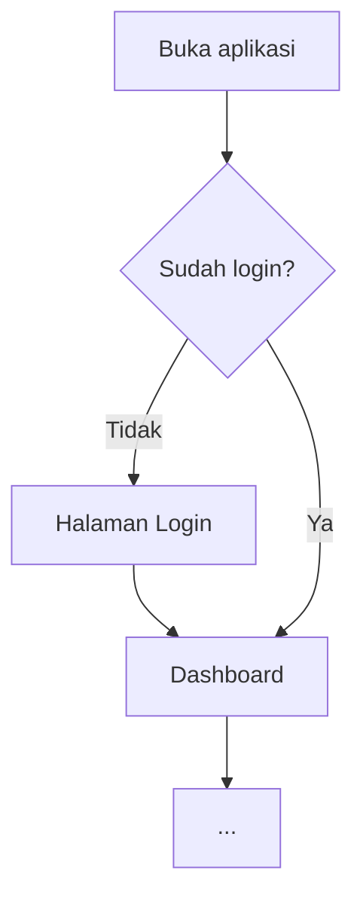
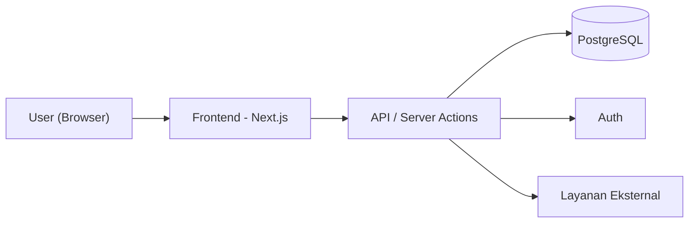
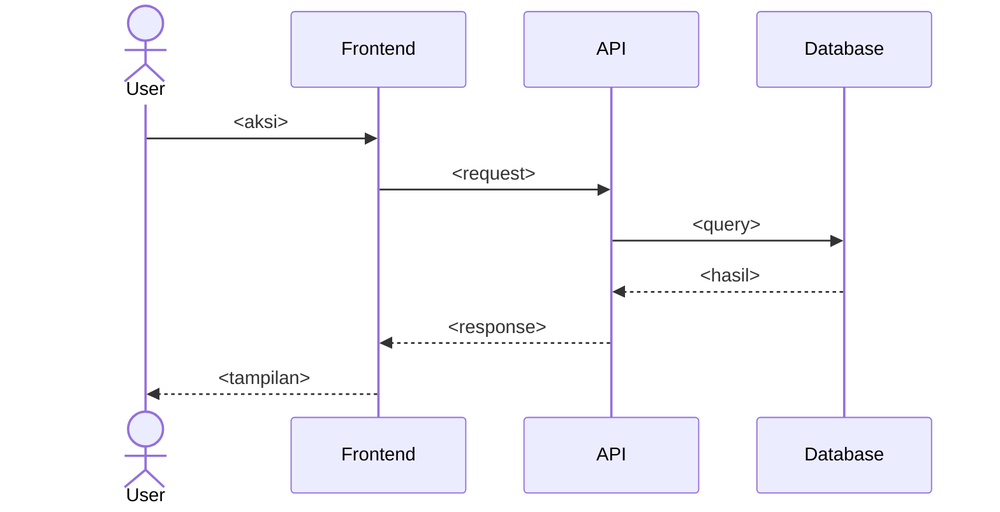
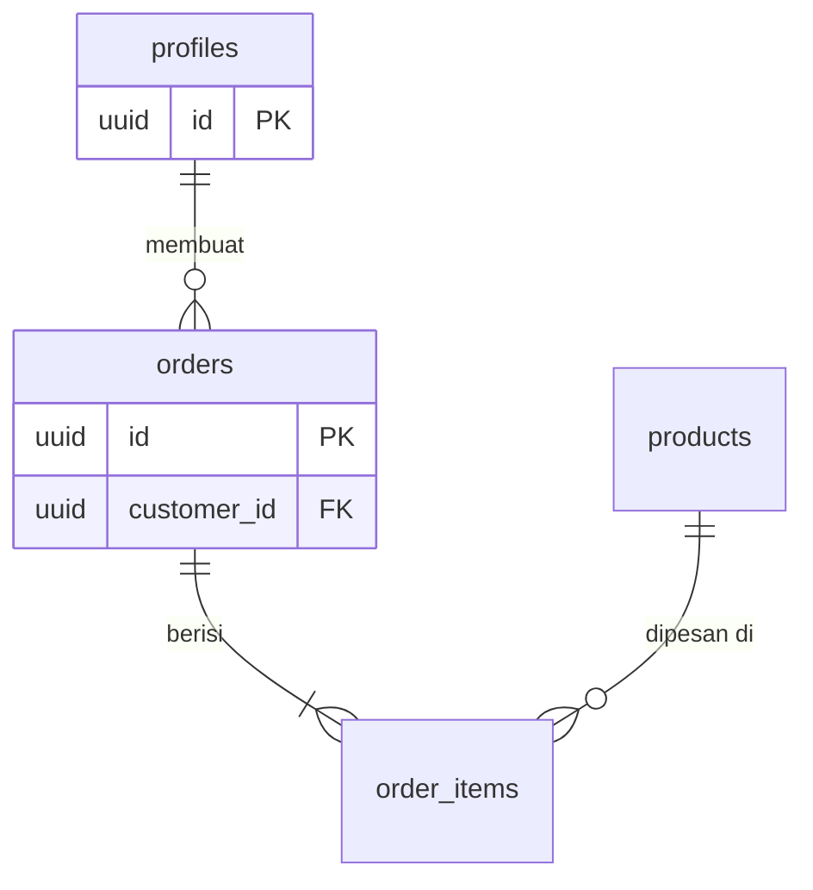
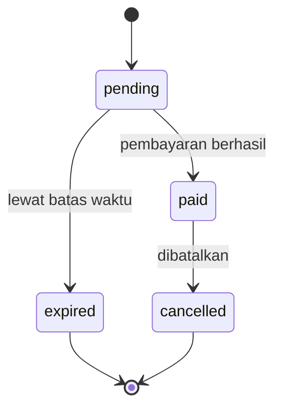

# Template PRD

Isi semua bagian di bawah. Teks dalam `<...>` adalah petunjuk, ganti dengan isi nyata. Hapus semua petunjuk di hasil akhir. Salin hanya isi di dalam blok `~~~markdown` (tanpa pagar `~~~`-nya).

---

~~~markdown
# PRD — <Nama Aplikasi>

> <Satu kalimat: aplikasi ini apa, untuk siapa, menyelesaikan masalah apa.>

| | |
|---|---|
| Versi | 1.0 |
| Tanggal | <YYYY-MM-DD> |
| Status | Draft |
| Platform | <Web / Mobile / Desktop> |

---

## 1. Overview

### 1.1 Latar Belakang & Masalah
<2–4 kalimat. Masalah nyata yang dialami target user sekarang, dan cara mereka mengatasinya saat ini.>

### 1.2 Solusi
<2–4 kalimat. Apa yang dilakukan aplikasi ini secara konkret.>

### 1.3 Target User
| Role | Identifier | Deskripsi | Kebutuhan utama |
|---|---|---|---|
| <Pemilik Toko> | `owner` | <siapa mereka> | <apa yang mereka butuhkan dari aplikasi> |
| <Kasir> | `cashier` | ... | ... |

<Kolom Identifier adalah nama role dalam kode (bahasa Inggris, snake_case). Identifier inilah yang dipakai di Requirements, User Flow, dan nilai kolom `role` di schema.>

### 1.4 Tujuan & Metrik Keberhasilan
- <Tujuan terukur berupa hasil nyata bagi user/bisnis, mis. "Kasir bisa mencatat transaksi < 10 detik" atau "80% pelanggan cek status sendiri tanpa chat ke owner">
- <...>

<Jangan menulis metrik yang otomatis terpenuhi oleh aturan sistem (mis. "0 order diambil sebelum lunas" kalau itu sudah dicegah constraint) — itu Business Rule, bukan metrik.>

### 1.5 Ruang Lingkup
**Termasuk (MVP):** <daftar singkat>
**Tidak termasuk (untuk saat ini):** <daftar singkat — penting agar AI agent tidak over-build>

### 1.6 Asumsi
- <Setiap hal yang kamu simpulkan sendiri karena tidak disebut user>

### 1.7 Risiko & Mitigasi
| Risiko | Dampak | Mitigasi / fallback |
|---|---|---|
| <mis. gateway WhatsApp tidak resmi diblokir> | <notifikasi & login OTP berhenti> | <mis. fallback login via email magic link, owner bisa kirim manual> |

<Fokus pada ketergantungan pihak ketiga dan titik gagal tunggal. Hapus kalau benar-benar tidak ada risiko berarti.>

---

## 2. Requirements

### 2.1 Functional Requirements
| ID | Requirement | Role | Prioritas |
|---|---|---|---|
| FR-01 | <Sistem harus/User dapat ...> | <role> | Must |
| FR-02 | ... | ... | Should |

<Prioritas memakai MoSCoW: Must / Should / Could. Setiap FR harus bisa diuji. Kolom Role = siapa yang memicu; proses otomatis (trigger, cron, webhook) memakai `system`.>

### 2.2 Non-Functional Requirements
| ID | Kategori | Requirement |
|---|---|---|
| NFR-01 | Performance | <mis. halaman utama load < 2 detik di 4G> |
| NFR-02 | Security | <mis. password di-hash, akses data dibatasi per user/role> |
| NFR-03 | Usability | <mis. responsif mulai lebar 360px> |
| NFR-04 | Reliability | <mis. backup database harian> |

<Hanya tulis NFR yang relevan dengan aplikasi ini.>

### 2.3 Business Rules
| ID | Aturan | Ditegakkan di |
|---|---|---|
| BR-01 | <mis. "Order hanya boleh berstatus `picked_up` kalau sudah lunas"> | <constraint / trigger / fungsi `nama_fungsi` / kode app> |
| BR-02 | ... | ... |

<Satu-satunya tempat aturan bisnis ditulis lengkap. Bagian lain cukup merujuk "BR-01". Setiap aturan punya SATU layer penegak utama.>

---

## 3. Core Features

### F-01 — <Nama Fitur>
- **Prioritas:** Must
- **Deskripsi:** <apa yang dilakukan fitur ini>
- **User story:** Sebagai <role>, saya ingin <aksi>, supaya <manfaat>.
- **Detail:**
  - <field / aturan bisnis / validasi yang spesifik>
- **Acceptance criteria:**
  - [ ] <kondisi yang bisa dicek, mis. "Transaksi tersimpan dan stok produk berkurang sesuai qty">
  - [ ] <...>
- **Terkait:** FR-01, BR-01, tabel `<nama_tabel>`, aksi `<nama_action>`

### F-02 — <Nama Fitur>
<...ulangi format yang sama...>

---

## 4. User Flow

### 4.1 Flow Utama — <nama flow, mis. "Onboarding sampai transaksi pertama">


**Catatan:** <hanya hal yang tidak terlihat di diagram: validasi, pesan error, data yang disimpan. Jangan mengulang langkah yang sudah jelas di diagram. Hapus kalau tidak ada.>

### 4.2 Flow <fitur penting lain>
<Diagram + langkah. Buat satu flow per fitur Must yang punya alur multi-langkah (tambah 4.3, 4.4, dst. bila perlu). Sertakan cabang error/gagal yang penting (validasi gagal, pembayaran gagal, dsb).>

### 4.x Daftar Halaman / Screen
<Selalu jadi sub-bagian terakhir di User Flow.>
| Halaman | Route | Role | Isi utama |
|---|---|---|---|
| Login | `/login` | publik | form email + password |
| Dashboard | `/dashboard` | <role> | <ringkasan> |

---

## 5. Architecture

### 5.1 Diagram Sistem


### 5.2 Komponen
| Komponen | Tanggung jawab |
|---|---|
| Frontend | <...> |
| Backend / API | <...> |
| Database | <...> |
| <Layanan eksternal> | <payment, email, storage, AI, dsb> |

### 5.3 Alur Data Penting
<Untuk 1–2 proses paling kritis (mis. checkout, sinkronisasi), jelaskan dengan sequence diagram.>


### 5.4 Aksi & Endpoint
| Aksi / Endpoint | Input | Output & error | Boleh dipanggil oleh | BR yang ditegakkan |
|---|---|---|---|---|
| `POST /api/<resource>` atau `createOrder()` | <field + tipe> | <hasil sukses; daftar error yang mungkin, mis. `WEIGHT_REQUIRED`> | <role> | <BR-01> |

<Tulis semua aksi yang MENULIS data. Untuk aksi baca cukup yang penting saja.>

**Fungsi database / RPC** (hapus kalau tidak ada):
| Fungsi | Security | Cek role di dalam | GRANT EXECUTE ke | Dipanggil dari |
|---|---|---|---|---|
| `<nama_fungsi>(params)` | <DEFINER / INVOKER> | <mis. `is_owner()` → raise kalau bukan owner> | <`authenticated`; dicabut dari `anon`, `public`> | <aksi `xxx`> |

<Untuk konten yang dibangun dari konfigurasi app (mis. template pesan yang butuh nama toko dari env var), tegaskan dibangun di layer mana dan bagaimana datanya sampai ke sana.>

### 5.5 Struktur Folder (rekomendasi)
```
<struktur folder singkat sesuai tech stack dan konvensi versi major yang dipakai di bagian 7>
```

---

## 6. Database Schema

### 6.1 ERD


<Nama entity di ERD = nama tabel di 6.2 (snake_case, sama persis). Di ERD cukup tulis kolom PK, FK, dan UK; kolom lengkap ada di 6.2.>

### 6.2 Detail Tabel

#### `<nama_tabel>`
<Satu kalimat fungsi tabel.>

| Kolom | Tipe | Constraint | Keterangan |
|---|---|---|---|
| id | uuid | PK, default gen_random_uuid() | |
| <kolom> | <tipe> | <NOT NULL / UNIQUE / FK → tabel.kolom> | <...> |
| created_at | timestamptz | NOT NULL, default now() | |
| updated_at | timestamptz | NOT NULL, default now() | |

<Ulangi untuk setiap tabel. Nama tabel & kolom snake_case bahasa Inggris.>

<Konvensi yang wajib diikuti saat mengisi tabel (ini instruksi, bukan isi PRD):
- Kalau auth memakai Supabase Auth, data user disimpan di tabel `profiles` (`id` FK → `auth.users.id`); kolom `role` tidak boleh bisa diubah oleh user itu sendiri.
- Nominal uang disimpan sebagai `integer` dalam rupiah (bukan float).
- Waktu disimpan sebagai `timestamptz`; sebutkan zona waktu tampilan (default Asia/Jakarta).>

### 6.3 Index, Constraint, Trigger & Aturan Akses
**Index:** <kolom yang sering difilter/di-join, mis. `orders(customer_id, created_at desc)`>

**Constraint & trigger** (rujuk BR):
| Nama | Jenis | Tabel | Menegakkan | Keterangan |
|---|---|---|---|---|
| `<no_overlap_booking>` | <exclusion constraint / check / trigger BEFORE UPDATE> | `<tabel>` | <BR-02> | <mis. `court_id` + `tstzrange`> |

**Aturan akses (RLS):**
| Tabel | SELECT | INSERT | UPDATE | DELETE |
|---|---|---|---|---|
| `<tabel>` | <owner: semua; customer: miliknya> | <hanya via fungsi `xxx`> | <...> | <tidak ada> |

### 6.4 Status Lifecycle
<Untuk setiap kolom `status` yang diubah oleh aksi user, gambarkan transisinya dan sebut aksi yang memicu tiap transisi. Status turunan (dihitung dari kolom lain) cukup satu kalimat aturan. Hapus bagian ini kalau tidak ada.>


---

## 7. Tech Stack

| Layer | Teknologi & versi major | Alasan |
|---|---|---|
| Frontend | <mis. Next.js 16 (App Router) + TypeScript 5> | <...> |
| Styling / UI | <mis. Tailwind CSS + shadcn/ui> | <...> |
| Backend | <mis. Next.js Server Actions / Route Handlers> | <...> |
| Database | <mis. PostgreSQL (Supabase)> | <...> |
| Auth | <mis. Supabase Auth> | <...> |
| Storage | <jika perlu> | <...> |
| Layanan eksternal | <payment gateway, email, AI API, dsb> | <...> |
| Deployment | <mis. Vercel> | <...> |

<Hapus baris yang tidak dipakai (mis. Storage atau payment gateway kalau tidak ada). Sebut versi major; kalau ragu dengan konvensi versi terbaru, cek dokumentasi resmi.>

### 7.1 Library Pendukung
- <validasi form, state management, chart, dsb — hanya yang benar-benar dipakai>

### 7.2 Environment Variables
| Variabel | Dipakai di | Keterangan |
|---|---|---|
| `<NAMA_VAR>` | <server / client / database> | <...> |

### 7.3 Konfigurasi Platform & Uji Lokal
| Platform | Setting | Nilai (production / dashboard) | Padanan lokal | Catatan |
|---|---|---|---|---|
| <Supabase Auth> | <mis. Phone provider, Allow signups, Confirm phone> | <ON> | <`supabase/config.toml`: `[auth.sms]`> | <harus ON karena pelanggan baru daftar via OTP> |
| <Supabase Auth Hook> | <Send SMS Hook URL> | <`https://<domain>/api/hooks/sms`> | <`config.toml` → `http://host.docker.internal:3000/api/hooks/sms`> | <dikecualikan dari redirect auth di proxy/middleware> |

**Cara menjalankan di lokal:** <langkah singkat: install, env, `supabase start`, `supabase db reset` (migrasi + seed), run dev server>

### 7.4 Rencana Implementasi Bertahap
1. **Fase 1 — Setup:** inisialisasi project, database, konfigurasi platform (7.3), auth.
2. **Fase 2 — Fitur Must:** F-01, F-02, ...
3. **Fase 3 — Fitur Should/Could:** ...
4. **Fase 4 — Polish & Deploy:** testing, optimasi, deploy.
~~~

---

## Panduan memilih Tech Stack (kalau user tidak menentukan)

| Jenis aplikasi | Default yang disarankan |
|---|---|
| Web app / SaaS / dashboard | Next.js + TypeScript + Tailwind + shadcn/ui + Supabase (Postgres, Auth, Storage) + Vercel |
| Mobile app | Expo (React Native) + TypeScript + Supabase |
| Landing page / konten statis | Next.js atau Astro + Tailwind, tanpa database kalau tidak perlu |
| Butuh realtime (chat, live update) | Tambahkan Supabase Realtime |
| Pembayaran di Indonesia | Midtrans atau Xendit |
| Fitur AI | API LLM sesuai preferensi user (mis. Claude, OpenAI, Gemini; model stabil terbaru) via server-side route |

Kalau project sudah ada, **selalu ikuti stack yang sudah dipakai** daripada default di atas.
